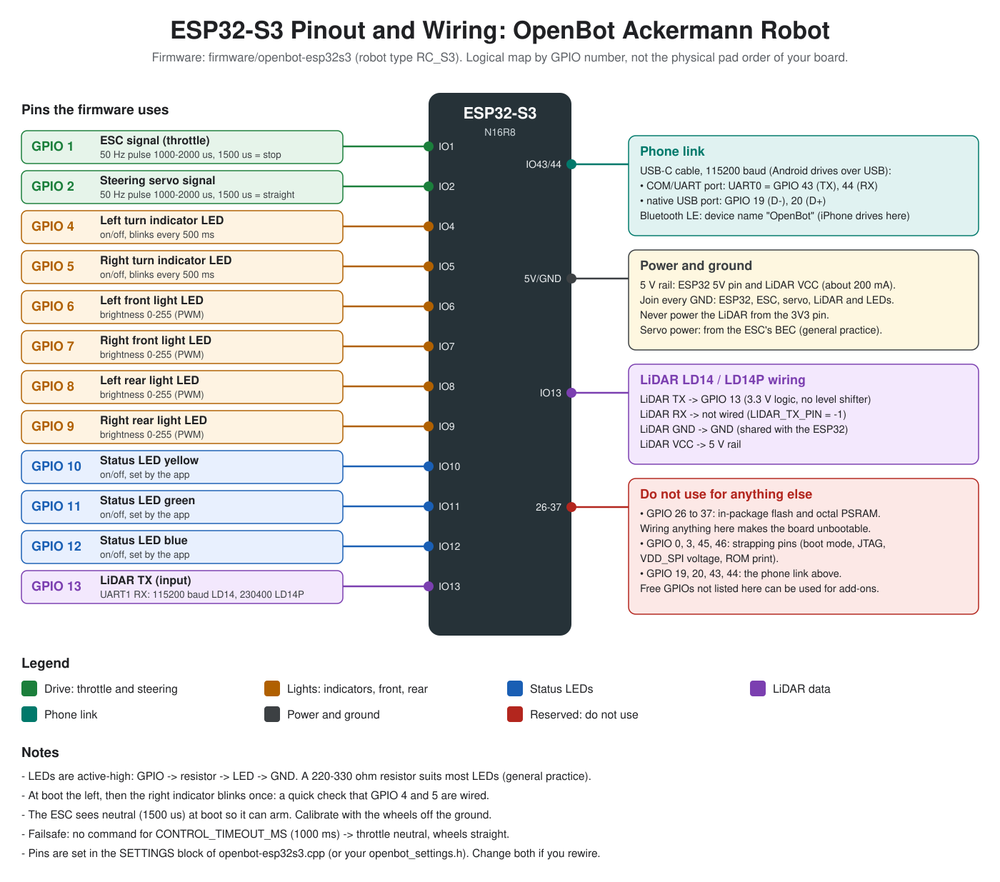

# Ackermann Robot (OpenBot, ESP32-S3)

An off-road 4WD car with Ackermann steering, controlled by an ESP32-S3 and driven by a phone or a Linux computer using the [OpenBot](https://github.com/ob-f/OpenBot) apps. A LiDAR stops the car before it hits things, and the phone's own GPS drives waypoint missions. A FlySky FS-i6 RC transmitter can take over at any time: one switch picks MANUAL (RC sticks), AUTO (phone) or HOLD (stop) - see the [firmware guide](docs/FIRMWARE_GUIDE.md#9-rc-controller-manual-and-auto).



## Guides

| Guide | What it covers |
|---|---|
| [Firmware guide](docs/FIRMWARE_GUIDE.md) | Wiring, Arduino settings, flashing, first power-on checks, calibration, commands, safety |
| [App guide](docs/APPS_GUIDE.md) | Android, iOS and Linux apps: connecting, GPS missions, LiDAR plan view, avoidance |
| [Pinout and wiring map](docs/ESP32S3_PINOUT.svg) | Every GPIO the firmware uses, the phone link, power, and pins to avoid |

## Folders

```
firmware/openbot-esp32s3/   ESP32-S3 firmware (ESC, steering servo, lights, LD14 LiDAR)
robot/android/              Android app: USB cable to the car, phone GPS, LiDAR over USB
robot/ios/                  iOS app (beta): Bluetooth to the car, phone GPS
robot/linux/                Python app: joystick, neural-network driving, GPS missions
docs/                       Guides and the pinout map
```

## Quick start

1. **Wire** the car using the [pinout map](docs/ESP32S3_PINOUT.svg).
2. **Flash** the firmware: Arduino IDE, board *ESP32S3 Dev Module*. See the [firmware guide](docs/FIRMWARE_GUIDE.md#5-flash-the-board).
3. **Check** with the wheels off the ground: the indicators blink left then right at boot, and the Serial Monitor (115200) shows the LiDAR.
4. **Connect** an app: Android by USB cable, iPhone by Bluetooth ("OpenBot"). See the [app guide](docs/APPS_GUIDE.md).

**Android APK:** download it from [Releases](https://github.com/quangvu16/Ackermann_robot_openbot/releases). A new release is built automatically when a version tag such as `v1.0.1` is pushed (see `.github/workflows/android-release.yml`).

## Not included

The Android app's Firebase config (`google-services.json`) is not in this repo, because it holds API keys; the build uses a dummy one. The iOS app no longer uses Firebase at all: it only needs `pod install`. Google sign-in on iOS (for Google Drive projects) turns on when you add an OAuth client ID as `GIDClientID` in `Info.plist`.

## Safety

The car can run away. Test on blocks first, keep a controller ready, and calibrate the ESC before driving on the ground. The firmware stops the car if no command arrives for 1 second.

## Licence

This repo is licensed under [Apache 2.0](LICENSE). The apps and firmware are based on [OpenBot](https://github.com/ob-f/OpenBot), whose code keeps its MIT licence: see [LICENSE-OpenBot](LICENSE-OpenBot).
